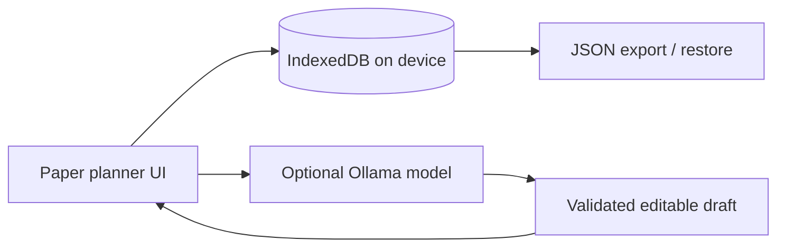

# slowly

**A gentle, local-first subscription keeper for people who would rather remember less.**

Slowly keeps subscription names, prices, renewal dates, account emails, and notes in the browser's IndexedDB. There is no account, analytics, server database, or cloud sync. The optional AI helper connects to [Ollama](https://ollama.com/) on your own machine, so a natural-language entry can become an editable draft without sending private subscription data away.

## Run it

Because this version has no build dependencies, open `index.html` directly in a browser. For the installable PWA and service worker, serve the folder from a local HTTP server, for example:

```powershell
py -m http.server 4173
```

Then open `http://localhost:4173`.

## Local AI

Install Ollama and pull a small model such as `llama3.2:3b`:

```powershell
ollama pull llama3.2:3b
```

Set `OLLAMA_ORIGINS=http://localhost:4173` if the browser blocks the local request. AI is optional: the normal form works without it, and the AI response is always presented as a draft that needs confirmation. Open the settings button in Slowly to change both the Ollama-compatible endpoint and model name; no source edit or API key is needed.

Any local service that implements the Ollama `/api/generate` shape can be configured. The app does not include a cloud endpoint, credentials, analytics, or personal data. If you prefer a cloud-compatible local gateway, configure it yourself at runtime and review its privacy policy first.

## Project structure

- `index.html` - accessible page structure and dialogs
- `styles.css` - readable paper-planner visual system
- `storage.js` - IndexedDB persistence and backup primitives
- `subscriptions.js` - validation, CRUD record creation, dates, and cost calculations
- `ollama.js` - optional local model connection and response handling
- `ui.js` - rendering, event wiring, and form workflows
- `app.js` - small application bootstrap
- `REQUIREMENTS.md` - functional, privacy, accessibility, and acceptance requirements

## Updating the app

The service worker uses a versioned cache and removes older caches during activation. If an older form still appears, reload once with `Ctrl+F5`, close any installed PWA window, and reopen it. There is no mobile-number field or requirement in the current app.

## Why open innovation matters

The useful part of Slowly is not just a chat prompt. It is the combination of a local data store, an offline-capable interface, and a model the user can run, replace, inspect, or turn off. An open-weight local model means subscription details can stay on the user's device, the app can keep working without a paid API, and the behavior can evolve without tying a personal finance-adjacent tool to one closed provider.



## Challenge fit: Slow and Steady

Slowly rewards laziness in a useful way: type one loose sentence instead of filling a form, glance at one renewal list instead of remembering dates, and keep everything close to home. The open/local approach is the product's privacy feature, not a decorative dependency.

## Current boundaries

- Browser notifications are not promised as a background scheduler; due dates are visible in the app.
- Ollama browser access may need local CORS configuration.
- The backup file is user-controlled, but importing untrusted JSON should still be done cautiously.
- There is no automatic cloud synchronization by design.